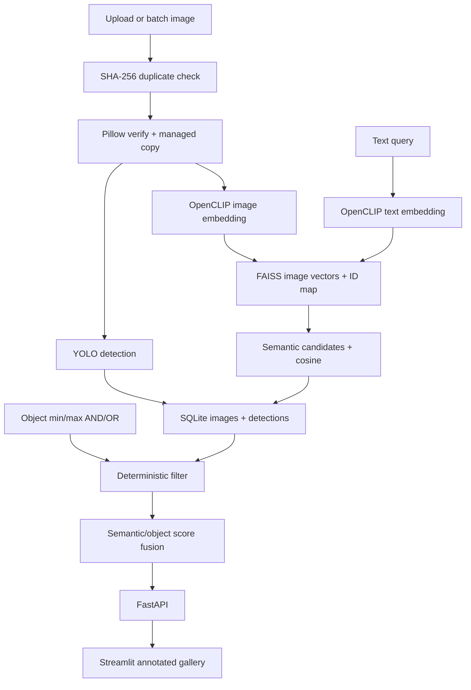

# Interview Prep: Hybrid Visual Search Engine

Read this from the top if you have forgotten the project. The first sections define the terms;
later sections explain architecture, code, metrics, limitations, operating steps, and interview
answers. Understand the trade-offs rather than memorizing sentences.

## 1. Thirty-second explanation

I upgraded a basic YOLO image-filtering demo into a hybrid visual retrieval platform. During
ingestion, YOLO11 detects objects and bounding boxes while OpenCLIP embeds the full image into a
semantic vector. SQLite stores hashes, model versions and normalized detections; FAISS stores
the normalized image vectors. At query time, CLIP embeds natural language, FAISS retrieves
semantically similar candidates, deterministic min/max object filters enforce expressions such
as two people and one bicycle, and a weighted fusion score ranks results. I exposed typed
FastAPI endpoints, an annotated Streamlit gallery, persistent indexes, batch/duplicate handling,
CPU/GPU configuration, Docker, tests, and a measured latency benchmark.

## 2. Definitions

### Computer vision and models

- **Computer vision**: software analysis of images or video.
- **Inference**: running a trained model to generate predictions.
- **Object detection**: predicts a class, confidence, and rectangular location for each object.
- **Classification**: predicts labels for an entire image; it does not locate objects.
- **Bounding box**: `(x1, y1, x2, y2)` rectangle around one detection.
- **Confidence threshold**: minimum detector score retained as a prediction.
- **Non-maximum suppression (NMS)**: removes overlapping duplicate detections.
- **YOLO**: “You Only Look Once,” a family of one-stage real-time object detectors.
- **YOLO11n**: small/nano Ultralytics YOLO11 checkpoint used in the measured run.
- **CLIP**: Contrastive Language-Image Pretraining; learns related image and text vectors.
- **OpenCLIP**: open-source CLIP implementation and pretrained model collection.
- **ViT-B/32**: Vision Transformer base model using 32-pixel patches.
- **Pretrained model**: model weights learned previously, reused without training from scratch.
- **Fine-tuning**: additional training on domain-specific labeled examples.
- **CPU inference**: executes model operations on the processor.
- **GPU inference**: executes parallel tensor operations on a compatible graphics processor.
- **CUDA**: NVIDIA software platform used by CUDA-enabled PyTorch builds.

### Embeddings and vector search

- **Embedding**: dense numeric vector representing features or meaning.
- **Shared embedding space**: text and images are comparable because related concepts occupy
  nearby vector directions.
- **Vector dimension**: number of numeric components. ViT-B/32 produces 512 here.
- **L2 normalization**: divides a vector by its Euclidean length so its norm becomes one.
- **Cosine similarity**: directional similarity, ranging approximately from -1 to 1.
- **Inner product**: dot product. For normalized vectors it equals cosine similarity.
- **Nearest-neighbour search**: finds stored vectors closest to the query vector.
- **FAISS**: Meta’s library for efficient dense-vector similarity search.
- **IndexFlatIP**: exact FAISS inner-product index; compares with every vector.
- **Approximate nearest neighbour (ANN)**: trades small recall loss for faster large-scale search.
- **HNSW**: graph-based ANN index with strong recall and memory cost.
- **IVF**: inverted-file index that searches selected vector clusters.
- **Product quantization (PQ)**: compresses vectors to reduce memory and improve scale.
- **Top-k**: highest-scoring `k` results.
- **Recall@k**: fraction of relevant results found in the top k.

### Retrieval and ranking

- **Semantic search**: retrieves by conceptual similarity rather than exact labels/keywords.
- **Structured filter**: deterministic condition such as `person >= 2`.
- **Candidate generation**: first-stage retrieval of a broader possible result set.
- **Reranking/fusion**: combines multiple scores to order candidates.
- **Hybrid retrieval**: combines semantic and structured signals.
- **AND filter**: every object constraint must match.
- **OR filter**: at least one constraint must match.
- **False positive**: irrelevant image retrieved or incorrect object detected.
- **False negative**: relevant image or object is missed.
- **Content hash**: SHA-256 digest used to identify duplicate image bytes.
- **Idempotent ingestion**: reprocessing identical content does not create duplicate records.

### System engineering

- **FastAPI**: typed Python API framework with OpenAPI documentation.
- **Pydantic**: runtime validation for request and response contracts.
- **SQLite**: embedded relational database used for metadata and audit events.
- **Normalized data**: detections stored as separate rows rather than one opaque JSON blob.
- **Persistent index**: FAISS data and image-ID map saved across restarts.
- **Lazy initialization**: heavy models load only when an endpoint needs them.
- **Batch indexing**: processes many files in one operation.
- **p50/p95 latency**: 50%/95% of measured requests complete at or below that duration.
- **Throughput**: work completed per time, here images indexed per second.
- **Cold start**: first model download/load and runtime initialization.
- **Warm measurement**: model already loaded; measures steady-state execution.
- **Docker image**: packaged application filesystem and dependencies.
- **Container**: running image instance.
- **CI**: automated lint, type, test, coverage and container checks on code changes.

## 3. What the original code did

The supplied project loaded YOLO11m, processed a directory, saved JSON metadata, let users
select object classes, and displayed matching images in Streamlit. That proved detection and
basic UI, but it had hardcoded CUDA, absolute paths from another machine, broad exception
handling, no CLIP/FAISS/API/persistence contract/tests/Docker/metrics, and confusing count logic:
the UI said threshold while implementing a maximum count.

The new code uses explicit `min_count` and optional `max_count`, separates engines from service
logic, stores normalized records, and adds semantic search. The legacy ZIP remains unmodified
and is not committed.

## 4. Architecture



The core design decision is not asking one model to do everything. CLIP is excellent at scene
meaning but not reliable exact counting. YOLO produces auditable named detections but only for
its class vocabulary. Combining them covers both user needs.

## 5. Ingestion step by step

1. CLI or upload endpoint receives a supported image path/file.
2. Extension and upload-size policies reject invalid inputs.
3. SHA-256 digest detects identical content under different names.
4. File is copied into managed storage using hash-prefixed name.
5. Pillow reads dimensions and verifies image integrity.
6. YOLO predicts classes, confidences and coordinates.
7. OpenCLIP preprocesses pixels and outputs a normalized 512-dimensional vector.
8. SQLite transaction inserts image identity and individual detection rows.
9. FAISS appends the image vector and in-memory position.
10. JSON map records FAISS position to SQLite image ID.
11. FAISS index and map are persisted.
12. Batch event stores counts, duration, throughput, device and backend.

One production gap: SQLite commit and FAISS save are not a distributed transaction. A crash
between them can diverge state. At scale, store embeddings in durable staging and atomically
swap versioned indexes after reconciliation.

## 6. Search step by step

Question: `people cycling in a city`, filters `person >= 2`, `bicycle >= 1`, mode `all`.

1. Pydantic validates query length, top-k, weights and count ranges.
2. OpenCLIP encodes query text into the same space as images.
3. FAISS returns a broader candidate set (`top_k * 10`, bounded).
4. Service maps each FAISS position to SQLite image ID.
5. SQLite reconstructs detections and object counts.
6. AND mode requires both counts; OR would require either.
7. Cosine is mapped from `[-1, 1]` to `[0, 1]`.
8. Final score equals semantic weight times semantic score plus remaining weight times object
   score. Object-only search uses zero semantic weight.
9. Results sort descending and return image URL, all score dimensions, counts and boxes.
10. UI requests annotated image endpoint to draw detections.

## 7. Storage design

`images` stores ID, original filename, managed path, hash, size, timestamp, detector and encoder
model. `detections` stores one row per object with indexed label and coordinates. `events` stores
batch errors and search latency. FAISS stores vectors only; `vectors.json` maps positions to
database IDs.

Why SQLite plus FAISS instead of pgvector? This portfolio version is portable, free, and exact.
PostgreSQL/pgvector becomes valuable for multi-process transactions, access control, metadata
joins and centralized operations. FAISS remains attractive for controlled high-performance
indexes, but the application must own persistence and sharding.

## 8. Model/provider interfaces

`Detector` requires name, device and `detect(path)`. `Encoder` requires name, dimension, device,
`encode_image` and `encode_text`. Real implementations are YOLO and OpenCLIP. Hash versions are
deterministic test doubles for CI.

Hash mode proves API, persistence, duplicate handling, filter semantics and benchmark plumbing.
It is not computer-vision or semantic-quality evidence. The README and health endpoint expose
the active backend so reviewers cannot confuse the modes.

## 9. Performance measurement

Verified bounded CPU run:

| Item | Value |
|---|---:|
| Corpus | 30 COCO validation images |
| Detector | YOLO11n |
| Encoder | OpenCLIP ViT-B/32 LAION2B |
| Index | FAISS IndexFlatIP |
| Warm indexing | 6.239 images/s |
| Warm time/image | 160.279 ms |
| Search samples | 20 |
| Search p50 | 56.676 ms |
| Search p95 | 70.754 ms |
| Search mean | 56.708 ms |

The host had an RTX 3050 but installed PyTorch was CPU-only, so the GPU did no work. Cold model
download/load was excluded. Search includes text encoding, FAISS, SQLite reads, filtering and
fusion. Never claim million-image scale from 30 images; use these numbers to show measurement
discipline.

At scale, separately measure model batch throughput, index build, recall@k, concurrent p50/p95/
p99, memory per vector, filtering selectivity, index load/recovery and cold start.

## 10. CPU and GPU support

`VISUAL_SEARCH_DEVICE=auto` uses CUDA only when `torch.cuda.is_available()` is true. Physical GPU
presence is insufficient: PyTorch must be built with compatible CUDA, drivers must match, and
containers need NVIDIA Container Toolkit access. The GPU Compose overlay reserves a GPU but the
runtime image must contain a CUDA-enabled PyTorch build. Always verify with actual inference and
report device from the application.

## 11. Every important file

| File | Responsibility |
|---|---|
| `config.py` | paths, model/backend/device and safety limits |
| `models.py` | detections, filters, search, health, index and benchmark contracts |
| `engines.py` | YOLO, OpenCLIP and deterministic engine ports |
| `store.py` | normalized SQLite schema, hashes, detections and events |
| `vector_index.py` | FAISS exact cosine index, NumPy fallback, ID mapping, persistence |
| `filters.py` | min/max count and AND/OR semantics |
| `service.py` | ingestion, search, fusion and benchmark orchestration |
| `api.py` | health, upload, search, image/class endpoints and annotations |
| `cli.py` | safe ZIP import, batch index, benchmark and search commands |
| `frontend/app.py` | uploads, semantic query, constraints, scores and image grid |
| `tests/` | persistence, duplicate, ranking, filters, API, rendering, CLI, benchmarks |
| `Dockerfile` | lightweight deterministic CPU/API/UI image |
| `Dockerfile.ml` | real CPU YOLO/OpenCLIP/FAISS image |
| Compose files | base services plus ML and GPU overlays |
| `reports/benchmark-cpu.json` | machine-readable measured baseline |
| `reports/BENCHMARK.md` | benchmark methodology and boundaries |
| `DATA_PROVENANCE.md` | supplied ZIP/model/data license boundary |
| `docs/ARCHITECTURE.md` | retrieval, persistence and scaling decisions |
| `docs/CASE_STUDY.md` | before/after portfolio narrative |
| `docs/DEMO_SCRIPT.md` | four-minute walkthrough |
| `.github/workflows/ci.yml` | lint, types, tests, coverage, Compose and Docker gate |

## 12. How it was built chronologically

1. Audited the supplied Streamlit/YOLO code and 500-image archive.
2. Kept source images and 40 MB model outside Git; added bounded safe import.
3. Defined typed detection, search, filter, health, index and metric contracts.
4. Created detector/encoder protocols and deterministic test engines.
5. Implemented YOLO11 and OpenCLIP real engines with device reporting.
6. Designed SQLite tables and content-hash idempotency.
7. Implemented persistent FAISS/NumPy index and ID map.
8. Added explicit minimum/maximum and AND/OR filters.
9. Built semantic candidate retrieval and weighted score fusion.
10. Added upload, batch, duplicate, error audit and benchmark paths.
11. Exposed typed FastAPI routes and lazy model initialization.
12. Built Streamlit upload/search/filter/annotated-result UI.
13. Added CPU, ML and GPU deployment configurations.
14. Tested deterministic infrastructure with 14 tests and 84.9% coverage.
15. Installed real free models, indexed 30 supplied images, ran hybrid search and benchmarked.
16. Documented verified numbers separately from unverified GPU/scale claims.

## 13. Run it after restarting your laptop

### Existing real-model local index

If a Docker demo is already running, execute `docker compose down` first so ports 8020 and 8504
are available. Then use two PowerShell windows.

PowerShell window 1:

```powershell
cd "C:\Users\taran\Documents\Playground\Projects\hybrid-visual-search"
$env:VISUAL_SEARCH_DEVICE = "cpu"
uv run uvicorn visual_search.api:app --port 8020
```

PowerShell window 2:

```powershell
cd "C:\Users\taran\Documents\Playground\Projects\hybrid-visual-search"
$env:VISUAL_SEARCH_API_URL = "http://localhost:8020"
uv run streamlit run frontend/app.py --server.port 8504
```

Open <http://localhost:8504> and <http://localhost:8020/docs>. Stop both with `Ctrl+C`.

### If dependencies or index are missing

```powershell
uv sync --extra dev --extra frontend --extra ml
uv run visual-search import-zip "C:\Users\taran\Downloads\data(1).zip" --limit 30
$env:VISUAL_SEARCH_DEVICE = "cpu"
uv run visual-search index runtime/source-images
```

### Docker lightweight infrastructure demo

```powershell
docker compose up --build -d
```

Open <http://localhost:8504>. Upload images before search. This is hash mode, clearly shown in
health/UI, and does not prove model quality.

### Docker real ML mode

```powershell
docker compose -f docker-compose.yml -f docker-compose.ml.yml up --build -d
```

The first build/model load is large. Stop safely with:

```powershell
docker compose down
```

## 14. Interview questions

**Why combine YOLO and CLIP?**

CLIP supports open-ended semantic language but is weak at exact counting. YOLO provides named,
localized, countable objects but only from a fixed vocabulary. Hybrid retrieval gives flexible
meaning plus deterministic constraints.

**Why retrieve before filtering?**

Semantic retrieval reduces metadata work to a candidate set. For highly selective structured
filters at large scale, the planner could filter IDs first and search a selector-aware index;
the optimal order depends on selectivity and index support.

**Why use IndexFlatIP?**

It is exact, simple and correct for a small corpus, establishing a recall reference. Approximate
indexes only become justified after scale/latency measurements.

**Why normalize vectors?**

It makes inner product equal cosine similarity and prevents vector magnitude from dominating.

**How do you handle duplicate images?**

SHA-256 content hash is unique in SQLite. Identical bytes are skipped even under different
filenames. Near-duplicate perceptual hashing is a separate future feature.

**What if SQLite succeeds and FAISS save fails?**

The index can diverge. Production uses staged embeddings, index build from durable source,
checksums, reconciliation and atomic blue/green index pointer swap.

**How would you scale to millions of images?**

Batch GPU workers, object storage, PostgreSQL metadata, sharded HNSW/IVF-PQ or managed vector
search, versioned indexes, replicas, cache, authentication, observability, load tests and
recall@k evaluation.

**How do you prove GPU acceleration?**

Application reports CUDA device, `torch.cuda.is_available()` is true, model tensors execute on
GPU, utilization is observed, and benchmark compares identical warm workloads. A GPU existing
in Device Manager is not proof.

**How do you evaluate search quality?**

Create human-reviewed query-to-relevant-image judgments and report recall@k, precision@k, MRR
or nDCG, plus slice metrics for counting, rare classes, compositional queries and detector
misses. Current project measures engineering performance, not a complete relevance benchmark.

**What are security risks?**

Malicious image decoders, decompression bombs, privacy/biometric data, unauthorized image access,
model supply-chain risk, path traversal, denial of service and sensitive embeddings. Production
needs MIME/malware scanning, decoded-pixel limits, auth, tenant isolation, signed storage URLs,
model pinning and retention policy.

**What design choice are you proud of?**

The system keeps deterministic test engines and real ML engines behind identical contracts and
reports which backend is active. That makes CI fast without misrepresenting mocks as CLIP/YOLO.

## 15. Limitations

- The measured corpus has 30 images; scale claims require larger experiments.
- No human-labeled relevance dataset yet, so there is no recall@k claim.
- COCO YOLO classes cannot detect arbitrary domain concepts.
- CPU benchmark excludes cold model load.
- Local PyTorch did not use the available GPU.
- Exact Flat index grows linearly in search work and memory.
- SQLite/FAISS commit is not atomic.
- Upload validation is basic; production needs stronger image security.
- Hash Docker mode is infrastructure-only.
- Fusion weight is configurable but not learned/calibrated.

## 16. Resume bullets

- Built a hybrid visual retrieval platform combining YOLO11 object detections, OpenCLIP
  embeddings and FAISS cosine search with deterministic min/max AND/OR object filters.
- Designed persistent ingestion with SHA-256 deduplication, normalized SQLite metadata,
  versioned model fields, FAISS ID mapping, FastAPI endpoints and an annotated Streamlit UI.
- Measured a real CPU baseline on 30 COCO images at 6.239 images/s indexing and 56.676 ms p50 /
  70.754 ms p95 end-to-end search across 20 queries.
- Added CPU/GPU-aware deployment configuration, Docker Compose overlays, CI, strict typing and
  14 tests with 84.9% source coverage.

Do not write “GPU-accelerated” as a measured result until a CUDA-enabled build is run. Say
“GPU-ready deployment path” or “CUDA-configurable” for the current verified state.

## 17. Final preparation checklist

Be able to draw ingestion and search flows, explain cosine/normalization, distinguish semantic
and object signals, describe AND/OR and min/max behavior, state benchmark boundaries, explain
why Flat is appropriate now, name the SQLite/FAISS atomicity gap, describe real GPU proof, and
run one query yourself. That is enough to discuss the project honestly at interview depth.
