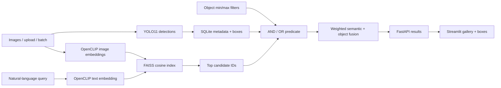

# Hybrid Visual Search

Hybrid Visual Search is a production-oriented retrieval system combining two independent
signals: OpenCLIP embeds image pixels and natural-language queries into a shared vector space,
while YOLO11 records exact object classes, confidences, counts, and bounding boxes. FAISS
retrieves semantically similar candidates; typed object constraints then enforce requirements
such as `person >= 2 AND bicycle >= 1`; a configurable fusion score ranks the survivors.

## Verified performance snapshot

The real-model CPU benchmark used 30 images imported from the supplied COCO validation archive:

- **YOLO11n** object detection;
- **OpenCLIP ViT-B/32 LAION2B** image/text embeddings;
- **FAISS `IndexFlatIP`** cosine retrieval;
- **6.239 images/second** warm indexing throughput;
- **160.279 ms/image** warm detection plus embedding;
- **56.676 ms p50** and **70.754 ms p95** end-to-end search over 20 queries;
- **14 automated tests** with **84.9% source coverage**.

The Windows PyTorch wheel was CPU-only. An RTX 3050 was present but was not used, so these are
not GPU claims. Model download/cold load is excluded; search includes CLIP text encoding,
FAISS, SQLite metadata reads, object filtering, and fusion. See
[`reports/BENCHMARK.md`](reports/BENCHMARK.md).

## Architecture



SQLite is the source of truth for image identity, hashes, model versions, and normalized
detections. The FAISS position-to-image-ID map is persisted separately. SHA-256 content hashes
provide idempotent ingestion. Models are provider ports, making deterministic CI possible
without pretending mock results are model quality.

## Run the existing local real-model index

The user-supplied data has already been indexed locally. Start two PowerShell windows.

Window 1:

```powershell
cd "C:\Users\taran\Documents\Playground\Projects\hybrid-visual-search"
$env:VISUAL_SEARCH_DEVICE = "cpu"
uv run uvicorn visual_search.api:app --port 8020
```

Window 2:

```powershell
cd "C:\Users\taran\Documents\Playground\Projects\hybrid-visual-search"
$env:VISUAL_SEARCH_API_URL = "http://localhost:8020"
uv run streamlit run frontend/app.py --server.port 8504
```

Open dashboard <http://localhost:8504> and API docs <http://localhost:8020/docs>.

## Rebuild the real-model index from the supplied ZIP

```powershell
uv sync --extra dev --extra frontend --extra ml
uv run visual-search import-zip "C:\Users\taran\Downloads\data(1).zip" --limit 30
$env:VISUAL_SEARCH_DEVICE = "cpu"
uv run visual-search index runtime/source-images
uv run visual-search benchmark --output reports/benchmark.json
```

First execution downloads free YOLO/OpenCLIP weights and may take several minutes. No API key is
required. The source ZIP is not modified.

## Docker options

Fast infrastructure demo with deterministic lightweight engines:

```powershell
docker compose up --build -d
```

Full CPU YOLO/OpenCLIP/FAISS image:

```powershell
docker compose -f docker-compose.yml -f docker-compose.ml.yml up --build -d
```

CUDA deployment on a machine with NVIDIA Container Toolkit and a CUDA-capable PyTorch image:

```powershell
docker compose -f docker-compose.yml -f docker-compose.ml.yml -f docker-compose.gpu.yml up --build -d
```

Open <http://localhost:8504> and <http://localhost:8020/docs>. Stop without deleting indexes:

```powershell
docker compose down
```

The lightweight Docker mode validates API/UI/persistence mechanics, not YOLO/CLIP quality. Use
the ML overlay for real retrieval.

## API

- `POST /v1/index/upload`: validate, hash, detect, embed, persist, and index one image.
- `POST /v1/search`: semantic query plus zero or more min/max object constraints.
- `GET /v1/images`: indexed image summaries.
- `GET /v1/images/{id}/content?annotated=true`: original or boxed image.
- `GET /v1/classes`: currently detected object vocabulary.
- `GET /health`: model/backend/device/index status without eagerly downloading models.

Example hybrid request:

```json
{
  "query": "people cycling in a city",
  "objects": [
    {"label": "person", "min_count": 2},
    {"label": "bicycle", "min_count": 1}
  ],
  "object_mode": "all",
  "top_k": 12,
  "semantic_weight": 0.75
}
```

## Quality checks

```powershell
uv run ruff check .
uv run ruff format --check .
uv run mypy src
uv run pytest --cov=visual_search --cov-report=term-missing
docker compose config --quiet
```

## Production boundaries

At larger scale, move metadata to PostgreSQL, use an IVF/HNSW/PQ FAISS index or managed vector
database, queue batch jobs, store images in object storage, add tenant authorization, scan
uploads, pin model artifacts, support index version swaps, monitor recall and drift, and load
test concurrent traffic. GPU support is configuration plus deployment—not a claim until a CUDA
build is run and measured.

The original ZIP contents and their license boundary are documented in
[`DATA_PROVENANCE.md`](DATA_PROVENANCE.md). Start with
[`INTERVIEW_PREP.md`](INTERVIEW_PREP.md) for definitions, every file and decision, build history,
interview answers, and restart instructions.

## License

[MIT](LICENSE)

