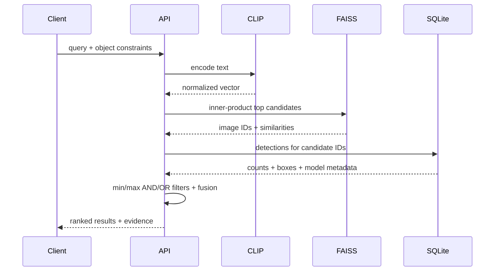

# Architecture and scaling decisions

## Retrieval contract

Semantic relevance and object truth are intentionally separate. CLIP can retrieve a visually
and conceptually similar scene even when YOLO has no matching class. YOLO provides discrete,
auditable constraints but cannot represent “busy urban atmosphere.” The service retrieves a
broad semantic candidate set, applies deterministic object predicates, then fuses scores.

## Ingestion

Each file is extension-checked, SHA-256 hashed, copied into managed storage, verified by Pillow,
detected by YOLO, embedded by OpenCLIP, and committed to normalized SQLite tables. The vector is
then added to FAISS and the index/map are persisted. Duplicate content is skipped regardless of
filename. Production should use a job state machine and atomic version swap so database and
vector commits cannot diverge after a process crash.

## Vector math

OpenCLIP emits L2-normalized image and text vectors. FAISS `IndexFlatIP` returns inner product;
for unit vectors this is cosine similarity. `IndexFlatIP` is exact and ideal for a small corpus.
At million-image scale, benchmark HNSW or IVF-PQ recall, memory, construction time, and latency.

## Fusion

Object predicates return pass/fail plus the fraction of constraints satisfied. After filtering,
semantic cosine is mapped from `[-1, 1]` into `[0, 1]` and combined with object score using the
request’s semantic weight. Object-only search sets semantic weight to zero.

## CPU/GPU boundary

YOLO and CLIP engines resolve `auto`, `cpu`, or `cuda`. CUDA requires a CUDA-enabled PyTorch
build, compatible driver/runtime, and container GPU access. The local measured build was CPU
only despite an NVIDIA GPU being physically present. This distinction prevents false GPU claims.

## Operational controls

- lazy model initialization keeps health checks independent of model download;
- upload extension and size limits reduce accidental abuse;
- content hashes make ingestion idempotent;
- model names and detection confidence are stored with every image;
- normalized detections support indexed class filtering;
- event rows preserve indexing errors and search latency;
- image content is served by database ID rather than caller-supplied path;
- model weights, source ZIPs, and images are excluded from Git.

## Scaling path

Use S3-compatible object storage, PostgreSQL metadata, Celery/Kafka workers, batched GPU
inference, model servers, index shards, blue/green index versions, replicas, signed upload URLs,
authentication/authorization, MIME and malware validation, rate limits, OpenTelemetry, recall
evaluation, and load tests. FAISS is not a distributed database; ownership and rebuild strategy
must be explicit.

